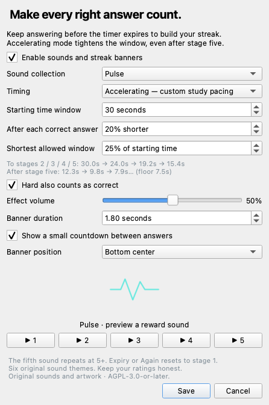

# Streak Lab for Anki

Build an answer streak with rising sounds, original emblems, and a shrinking countdown. Free, open-source, and entirely offline.



## Install

Download **Streak-Lab.ankiaddon** from [Releases](https://github.com/PsychMajor/valorant-streak/releases/latest). In Anki desktop, open **Tools → Add-ons → Install from file…**, choose the package, and restart. Then open **Tools → Streak Lab…** to choose your theme and timing.

Requires Anki desktop with Qt 6. Tested with Anki **26.8.1 on macOS** using its actual hooks and Qt libraries; other versions and operating systems have not been verified. Desktop add-ons do not run in AnkiMobile, AnkiDroid, or the AnkiWeb study interface. AnkiWeb hosts the download for desktop users.

If you have the personal Valorant Streak prototype, use only one version at a time to avoid duplicate effects. This public release has its own package ID and does not replace that prototype's files or settings.

## How it works

Rate a card Hard, Good, or Easy to start a streak. Keep rating correctly before the countdown runs out to reach five reward stages. The fifth sound repeats for subsequent successes while the counter keeps growing. Again or an expired countdown resets it. Hard can be excluded in settings.

**Accelerating mode** starts with a 30-second window, then shortens each new window by 20%, down to 7.5 seconds. Both the starting time and shrink rate are adjustable. **Fixed mode** keeps the same window throughout.

The timer measures the gap between ratings, including reading the question and viewing the answer. Your own rating determines success; the add-on does not automatically grade answers. Rate honestly, even when a streak is on the line. Leaving reviews, undoing a rating, opening settings, or closing a profile resets the streak. Switching to another application does not pause the timer.

## Six original themes

| Theme | Sound | Emblem |
| --- | --- | --- |
| Pulse | Crisp electronic impact | Waveform |
| Prism | Bright bell tones | Faceted diamond |
| Orbit | Soft modulated synth | Orbiting rings |
| Ember | Warm harmonic tones | Flame |
| Circuit | Arcade harmonics | Circuit |
| Bloom | Gentle chimes | Flower |

Each theme includes five sounds, for **30 original effects**. Adjust volume, popup duration, banner position, and countdown visibility, or disable rewards entirely. The add-on does not modify cards, notes, scheduling, or card audio. No server, account, telemetry, or network access is required.

## Development and validation

```sh
python3 -m unittest discover -s tests -v
python3 scripts/build.py
```

The resulting package is `dist/Streak-Lab.ankiaddon`. The build includes only the listed runtime files, license, and catalog-referenced assets; no caches, local preferences, or developer files. Asset paths must stay inside the assets directory.

All sounds and vector art are generated from scratch by `scripts/generate_assets.py`, using Python's standard library. Run that script to reproduce the assets. There are no recordings, game samples, downloaded images, or third-party sound packs.

`addon/core.py` contains pure timing rules; `addon/__init__.py` integrates review hooks, Qt overlays, settings, and playback. Thirteen rule tests cover rolling deadlines, exact expiry, ratings, resets, accelerating windows, fifth-stage repeats, and invalid settings. An isolated Qt smoke test additionally checks settings, overlays, undo/reset hooks, all six emblems, and decoding all 30 WAV files. It does not open a personal Anki collection.

To run `scripts/smoke_anki.py`, use a Python interpreter matching your installed Anki runtime and put its `app_packages` on `PYTHONPATH`; `QT_QPA_PLATFORM=offscreen` runs without displaying the test window.

Report bugs using [GitHub Issues](https://github.com/PsychMajor/valorant-streak/issues), including your Anki version, operating system, and steps to reproduce. Please do not attach your collection or private card content.

## License and project history

Code, generated sounds, and geometric artwork are licensed under **GNU AGPL v3 or later**; see LICENSE. The first source snapshot was a personal Valorant-inspired prototype, which explains the repository URL. The public Streak Lab package includes original assets and branding. It is not affiliated with Riot Games or Ankitects and does not reproduce verified game timing.
